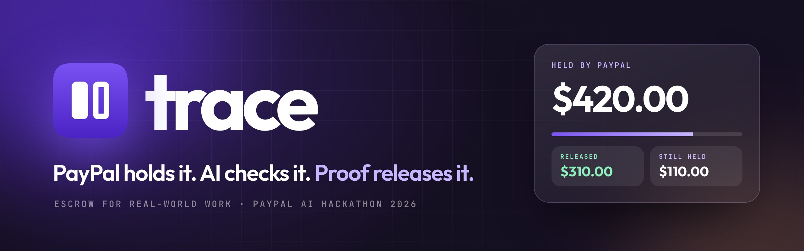
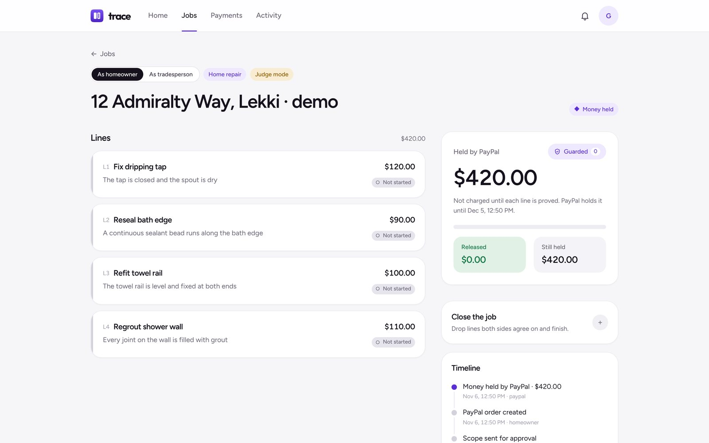
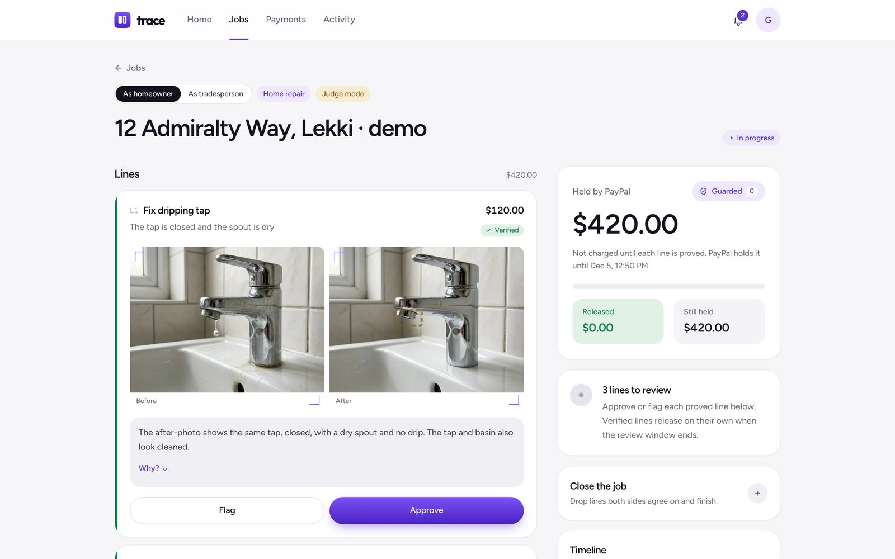
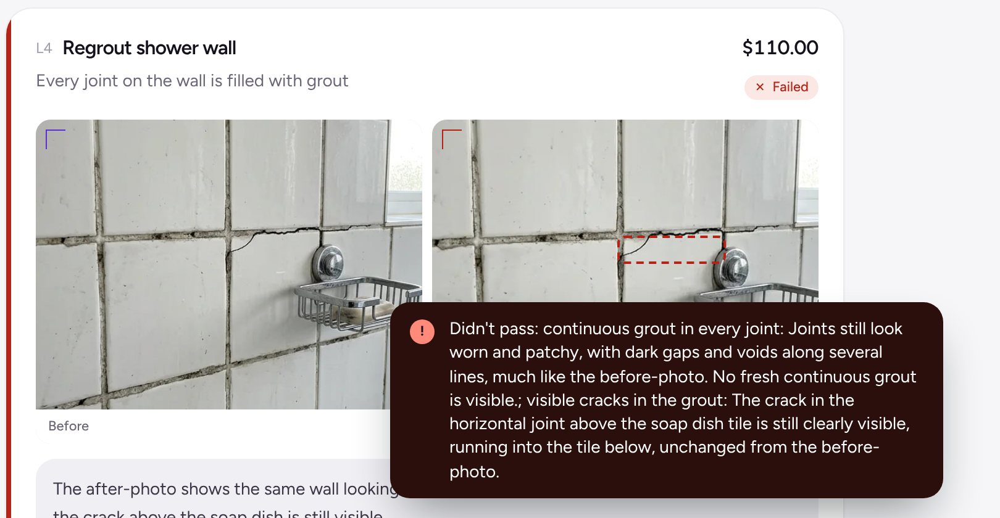
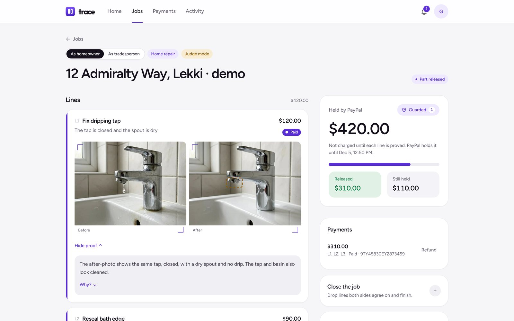
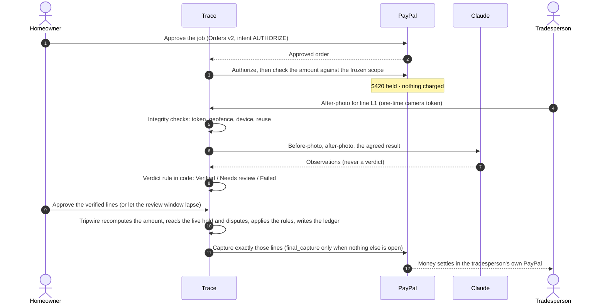
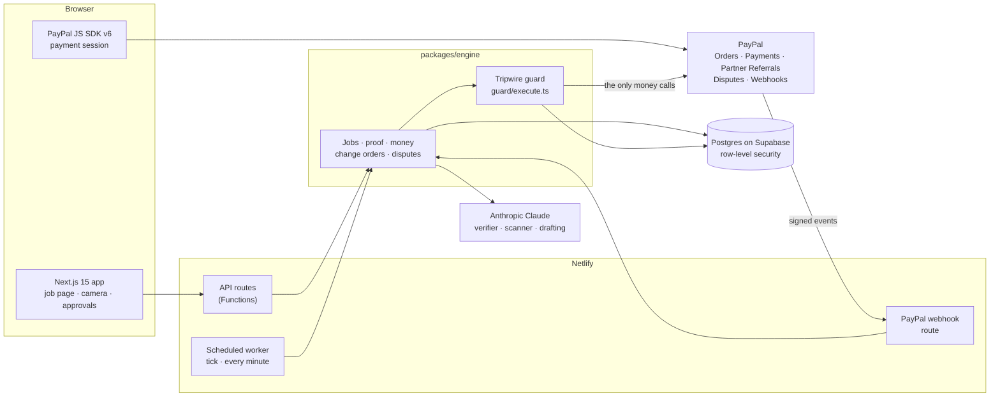
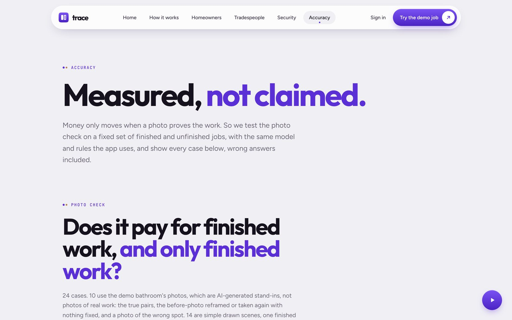

<p align="center">
  
</p>

<p align="center">
  <a href="https://trace-proof.netlify.app/try"><b>Try the demo job</b></a> ·
  <a href="https://trace-proof.netlify.app">Live site</a> ·
  <a href="https://trace-proof.netlify.app/accuracy">Accuracy results</a> ·
  <a href="docs/going-live.md">Going live</a>
</p>

<p align="center">
  <a href="https://github.com/linoxbt/Trace/actions/workflows/ci.yml"></a>
  
  
  
</p>

# Trace

**Trace holds a client's payment with PayPal and releases it line by line, only when AI verifies a photo that proves each part of the job is done.**

Paying for work up front is a leap of faith, and so is doing the work before you're paid. Trace removes the leap. The client approves the job once with PayPal and the full amount is authorized, not charged. The tradesperson proves each line of the job with a photo. Claude compares it with the before-photo and the agreed result, a fixed rule in code turns that into a verdict, and PayPal captures exactly the lines that passed, straight into the tradesperson's own PayPal account. Unfinished work stays held.

It works for any on-site job a camera can check: home repairs, cleaning, car work, gardens, removals, installations and event set-up.

Built for the [PayPal AI Hackathon](https://paypalaihackathon.devpost.com/). Everything runs on the PayPal sandbox; no real money moves.

---

## Contents

- [For judges: try it in three minutes](#for-judges-try-it-in-three-minutes)
- [How it works](#how-it-works)
- [What's in the box](#whats-in-the-box)
- [Architecture](#architecture)
- [PayPal integration](#paypal-integration)
- [Where the AI fits](#where-the-ai-fits)
- [Tripwire: one guard for every money move](#tripwire-one-guard-for-every-money-move)
- [The money lifecycle in detail](#the-money-lifecycle-in-detail)
- [Accuracy](#accuracy)
- [Verified on the live sandbox](#verified-on-the-live-sandbox)
- [Getting started](#getting-started)
- [Testing](#testing)
- [Deployment](#deployment)
- [Known limitations](#known-limitations)
- [Tech stack](#tech-stack)
- [Licence](#licence)

---

## For judges: try it in three minutes

Open **https://trace-proof.netlify.app/try**. It starts a guest session (no sign-up) and opens your own copy of a $420 bathroom job in four lines. A switch at the top lets you play both sides.

| Step | As | What to do | What you'll see |
| --- | --- | --- | --- |
| 1 | Homeowner | Press **Pay with PayPal** and log in with the sandbox buyer shown on the job page. | PayPal's own window; then **$420 held, $0 charged**. |
| 2 | Tradesperson | On each line, press a **Use sample proof** photo. | The real Claude check runs; verdicts arrive live with a plain-words reason. |
| 3 | Tradesperson | On L4 choose **Grout not finished**. | The line fails and its $110 stays held. |
| 4 | Homeowner | Approve L1 to L3 and press **Release now**. | PayPal captures **$310**; **$110 is still held**. |
| 5 | Both | Re-prove L4 with **Grout redone**, approve, release. | The final $110 is captured and the job completes. |

Sample proofs skip only the camera, location and device checks; the AI check, the reuse checks and the guard all run for real. If the buyer login isn't shown, create a free sandbox personal account under *Testing tools → Sandbox accounts* at [developer.paypal.com](https://developer.paypal.com/dashboard/accounts).

<table>
  <tr>
    <td width="50%"></td>
    <td width="50%"></td>
  </tr>
  <tr>
    <td><sub><b>Held, not charged.</b> The money card shows the hold and when PayPal's hold ends. Every money move is marked Guarded.</sub></td>
    <td><sub><b>Verified.</b> The after-photo beside the before-photo, the region the model looked at, and its reason in plain words.</sub></td>
  </tr>
  <tr>
    <td></td>
    <td></td>
  </tr>
  <tr>
    <td><sub><b>Failed.</b> Unfinished work is caught and explained; its money stays held.</sub></td>
    <td><sub><b>Paid line by line.</b> PayPal captured exactly the approved lines: $310 released, $110 still held.</sub></td>
  </tr>
</table>

---

## How it works



Three ideas carry the design:

1. **PayPal holds the money; Trace never does.** Each tradesperson connects their own PayPal account through PayPal's Partner Referrals, and every order names that account as the payee.
2. **AI observes; code decides.** Claude describes what it sees against the line's acceptance criteria. A fixed rule in code turns those observations into a verdict, and only approved lines can be captured.
3. **One guard in front of every money call.** Captures, voids, reauthorizations, refunds and dispute filings all pass through a single function that re-reads PayPal, applies the rules and writes the decision down before PayPal is called.

---

## What's in the box

| Area | Capabilities |
| --- | --- |
| **Jobs and scope** | Seven job types with their own vocabulary (homeowner/tradesperson, client/cleaner, car owner/mechanic, host/vendor); lines with plain-words acceptance criteria; AI scope drafting from before-photos; change orders with their own PayPal hold. |
| **Proof** | In-app camera with one-time tokens and a 150 m geofence; video, meter readings, documents, receipts, links and files; signed attestations by a named person; reuse detection by perceptual hash against every stored photo. |
| **Verification** | Claude vision verifier with a second look on crops; verdicts Verified, Needs review or Failed, each with a reason; planted-note scanning and masked re-judging. |
| **Money** | Authorize once; partial and final captures; review windows with auto-approval of Verified lines; close by agreement with a void of the remainder; reauthorization after the honor period; warnings and a guarded release before the hold lapses; full and partial refunds. |
| **Safety** | Tripwire guard with twelve built-in rules, three presets and people's own plain-English rules; approvals; an append-only decision ledger; per-person AI cost caps; optional Cloudflare Turnstile. |
| **Disputes** | Live dispute checks before any money moves; an evidence PDF of photos, timeline and verdicts; an AI-drafted response using the PayPal Agent Toolkit; evidence filed to PayPal through the guard. |
| **Operations** | Verified, de-duplicated webhooks with back-off; a scheduled worker every minute; migrations shipped inside the worker; `/api/health` with an uptime check every 15 minutes; automatic deletion of photos and location data after 180 days. |
| **Transparency** | Live updates over Supabase Realtime; a timeline of every event and PayPal webhook; a public accuracy page with every case shown. |

---

## Architecture



The code is a pnpm monorepo. Pure domain logic has no I/O; everything that talks to PayPal, Postgres or a model sits behind an interface with a fake for tests.

| Path | Responsibility |
| --- | --- |
| `packages/core` | Pure domain: money, state machines, capture planning, verdict policy, integrity checks, the guard's rules and evaluator, schemas. |
| `packages/paypal` | PayPal client: orders and payments on PayPal's Server SDK, a hand-written client for disputes, partner onboarding and webhook verification, and `FakePayPal` for tests. |
| `packages/db` | Migrations (001 to 021), the migration runner and typed queries. |
| `packages/engine` | The flows: jobs, proof, money, holds and their expiry, webhooks, disputes, change orders, the guard, AI clients; photo normalisation and dHash with `sharp`. |
| `apps/web` | Next.js 15 app: pages, API routes, the PayPal webhook, and the scheduled function `netlify/tick.mts`. |
| `apps/worker` | The same periodic jobs as a long-running process with `/healthz`, for hosts with always-on processes. |
| `eval` | The verifier and planted-note evaluation sets, their scoring and the server runner. |
| `scripts` | `sandbox-e2e.ts` (the engine against the real PayPal sandbox) and the two evals. |
| `brand` | Logo files, colours and type ([brand/README.md](brand/README.md)). |
| `docs` | [Going live](docs/going-live.md), [APIMatic Context Plugin notes](docs/apimatic.md), the demo-video script, index SQL. |

---

## PayPal integration

| PayPal tool | What it does in Trace | Where |
| --- | --- | --- |
| **Orders v2**, `intent: AUTHORIZE` | Creates the order from the stored lines, names the tradesperson as payee, authorizes on approval and checks the authorized amount against the frozen scope. | `packages/paypal/src/sdk.ts`, `packages/engine/src/jobs.ts` |
| **Payments v2** | Partial captures with `final_capture`; reauthorization after the honor period; voids; capture lookups; full and partial refunds acting for the tradesperson with `PayPal-Auth-Assertion`. | `packages/engine/src/guard/paypal-money.ts` |
| **PayPal Server SDK 2.5.0** | Every order and payment call goes through `OrdersController` and `PaymentsController`, written with APIMatic's Context Plugin; a 16-test contract suite checks it against the hand-written client. | [docs/apimatic.md](docs/apimatic.md) |
| **JavaScript SDK v6** | The "Pay with PayPal" payment session in the browser. | `apps/web/src/components/hold-button.tsx` |
| **Partner Referrals** | Tradespeople connect their own PayPal (features `PAYMENT`, `REFUND`, `READ_SELLER_DISPUTE`, `UPDATE_SELLER_DISPUTE`); Trace confirms the linked account can take payments before a scope can be sent. | `packages/engine/src/payee.ts` |
| **Disputes** | Lists disputes live before any money moves (an open dispute blocks captures) and files evidence: a PDF and a written response. | `packages/engine/src/disputes.ts` |
| **Webhooks** | Verified against the raw body, de-duplicated on event ID, retried with back-off; reconcile holds, captures, refunds, disputes and onboarding. | `packages/engine/src/webhooks.ts` |
| **PayPal Agent Toolkit 1.11.0** | Gives the dispute assistant read-only tools (`get_dispute`, `get_order`, `list_transactions`). Agents can draft; they can never move money. | `apps/web/src/server/dispute-agent.ts` |

Webhook events Trace subscribes to: `CHECKOUT.ORDER.APPROVED`, `PAYMENT.AUTHORIZATION.CREATED`, `PAYMENT.AUTHORIZATION.VOIDED`, `PAYMENT.CAPTURE.COMPLETED`, `PAYMENT.CAPTURE.PENDING`, `PAYMENT.CAPTURE.DENIED`, `PAYMENT.CAPTURE.DECLINED`, `PAYMENT.CAPTURE.REFUNDED`, `CUSTOMER.DISPUTE.CREATED`, `CUSTOMER.DISPUTE.UPDATED`, `CUSTOMER.DISPUTE.RESOLVED`, `MERCHANT.ONBOARDING.COMPLETED`, `MERCHANT.PARTNER-CONSENT.REVOKED`, `CUSTOMER.MERCHANT-INTEGRATION.SELLER-EMAIL-CONFIRMED` and `CUSTOMER.MERCHANT-INTEGRATION.CAPABILITY-UPDATED`.

---

## Where the AI fits

| Model | Role | How it's kept honest |
| --- | --- | --- |
| **Claude Opus 5.5** | Photo verifier | Returns observations against the line's acceptance criteria. Code turns them into a verdict; a second look runs on crops; Needs review never auto-releases. |
| **Claude Haiku 5.5** | Planted-note scanner; rule read-back | Lists every piece of text in proof and before-photos. Text in a Verified proof is painted out and the line judged again; a changed verdict goes to the homeowner. A failed scan never counts as "no text". |
| **Claude Sonnet 5.5** | Scope drafting; rule compiler; dispute drafting | Rules compile only to fields the guard checks, are read back blind by Haiku and backtested; they can only ask first or block. Dispute drafts use the PayPal Agent Toolkit's read-only tools. |

Every AI call is capped per person per hour (`packages/engine/src/budget.ts`), and guests and demo jobs share one hourly allowance.

---

## Tripwire: one guard for every money move

AI reads the photos; it never moves the money. Every capture, void, reauthorization, refund and dispute filing goes through one function, `packages/engine/src/guard/execute.ts`, in the same five steps:

1. **Check the action.** A capture's amount is recomputed from the stored lines, never taken from a request or a model. The one amount a person types is a refund's, which needs both sides' approval and can't exceed what was paid.
2. **Read live facts.** The hold's status comes from PayPal, and disputes are listed at PayPal too, not only when a webhook arrives. If PayPal can't be read, the answer is deny: nothing moves.
3. **Trace the inputs.** Every input is labelled with how far it can be trusted. Photos, and anything a model read from them, are never trusted as instructions.
4. **Apply the rules.** The twelve built-in rules (B1 to B12) come first, then the presets and people's own rules. Deny beats ask-first, and ask-first beats allow.
5. **Write the decision down, then act.** The decision goes to `guard_decisions`, which a database trigger keeps append-only. Only then is PayPal asked.

Only `execute.ts` can import the money client (`guard/paypal-money.ts`), and a test fails if any other file calls a money-moving PayPal method.

**Approvals.** When a rule asks first, an approval request opens. It expires after 24 hours (5 minutes in demo mode). Approving re-runs the guard on the same frozen action with the approval attached, so the built-in deny rules still apply; "both" needs a tap from each side. A request whose lines were paid another way meanwhile is closed automatically.

**Presets**, on by default:

| Preset | Asks the homeowner first when |
| --- | --- |
| P1 | A release over $150 that the homeowner didn't start, unless PayPal's hold lapses within 24 hours. |
| P2 | More than $300 would go out within 24 hours without the homeowner starting it, unless PayPal's hold lapses within 24 hours. |
| P3 | It would be the 4th or later release within 10 minutes. |

**People's own rules.** Written in plain English, compiled by Claude Sonnet 5.5 to rule JSON using only the fields the guard checks ("unsupported" rather than a guess), read back by Claude Haiku 5.5 without seeing the original words, and backtested against the person's past decisions. Rules can only tighten; nothing a person writes can loosen a built-in rule.

**Planted notes.** Text in a proof photo can't steer a verdict:

1. Claude Haiku 5.5 lists the text in every proof photo and before-photo, beside the verifier's first look.
2. If a Verified proof has any text, the text is painted out on a stored copy (`sharp`, 8% padding) and the line is judged again on the masked pair.
3. If the verdict changes, or the text was aimed at the inspector, the line goes to Needs review, and the homeowner sees the note outlined beside the masked copy.

Scopes are checked the same way when they're sent, for instructions aimed at the AI. Rule B12 asks the homeowner before an automatic release of a line priced at 3× or more what the AI drafter suggested for it. AI agents can draft (rule B6) but never trigger a money move.

---

## The money lifecycle in detail

0. **The tradesperson is paid directly.** Trace is a PayPal partner. In Settings, a tradesperson taps **Connect PayPal** and signs up or logs in through PayPal's partner sign-up. When they return, Trace asks PayPal which account was linked under their tracking ID (the return URL's query string is ignored) and whether it can take payments, has a confirmed email and granted the permissions; a scope can only be sent once all three hold. Every order names that account as `payee.merchant_id`, so captured money settles in the tradesperson's PayPal and never in Trace's. The payee is frozen on the job when the order is created, and Trace refuses an authorization whose order pays anyone else. Sandbox demo jobs, where one person plays both sides, pay the partner account.
1. **Authorize.** The homeowner approves an order with `intent: AUTHORIZE`. Trace authorizes it on the server and checks the authorized amount against the frozen scope.
2. **Prove.** For each line, the in-app camera issues a one-time token valid for 120 seconds. The after-photo goes through the integrity checks (token, 150 m geofence, device, dHash against the before-photo and every stored photo), then the verifier returns observations and code turns them into Verified, Needs review or Failed.
3. **Review.** The homeowner approves or flags each proved line. Silence approves a Verified line once its review window lapses; a Needs review line never auto-releases.
4. **Capture.** A release captures exactly the approved lines, with `final_capture: false` until no other line is open. Amounts are recomputed from line states in a locked transaction and can never exceed the authorization.
5. **No double charges.** A capture is recorded with its `PayPal-Request-Id` before it is sent. A lost response is retried with the same ID, so it can't become a second capture; only a definite refusal frees the lines again, and the timeline says nothing was charged.
6. **Close.** Closing needs both sides to agree which lines to drop. What is approved goes in a final capture; the rest is voided.
7. **Renew.** After the 3-day honor period, the worker reauthorizes once while lines are still open. A refusal is recorded and flagged for both sides, not retried.
8. **The end of the hold.** A PayPal authorization lasts 29 days from when it was placed, and renewing it doesn't extend that (`packages/engine/src/hold-expiry.ts`):
   - Three days before, both sides are told which lines are still unpaid, and the money card shows the countdown.
   - In the last 24 hours, approved lines still unpaid are released through the guard. Presets P1 and P2 stand aside, so verified work the homeowner never answered for is paid; every built-in rule still applies, so a dispute, a flagged line or a planted note still stops it. A refused attempt is retried every 2 hours, not every minute.
   - Once the date has passed, the worker asks PayPal. When PayPal reports the hold expired or voided, Trace records it and closes the job, even if PayPal's webhook never arrives. The rest of the client's money was never charged; PayPal simply stops holding it.
9. **Reconcile.** Webhooks are verified with PayPal against the raw body, de-duplicated on event ID and used to reconcile captures, voids, refunds and disputes.

---

## Accuracy



The photo check and the planted-note scanner run on the deployed site with its own model key, through the same verifier, second look and verdict rule the app uses. Every case, right or wrong, is published at **[/accuracy](https://trace-proof.netlify.app/accuracy)**.

| Evaluation | Set | Result |
| --- | --- | --- |
| **Photo check** (run 6 Nov 2026) | 24 cases: 10 demo-bathroom pairs (true pairs, the before-photo reframed with nothing fixed, the wrong spot) and 14 drawn scenes, one finished and one unfinished per job type | **11/11** finished jobs verified · **13/13** unfinished or wrong jobs kept from payment · **0** unfinished jobs wrongly paid · **0** finished jobs sent to review |
| **Planted notes** (run 5 Nov 2026) | 30 images: 20 notes aimed at the checker (English, Pidgin, Yoruba and Spanish, including faint and cut-off text) and 10 ordinary labels | **20/20** caught (target ≥95%) · **1/10** ordinary labels flagged (target ≤10%): "Handle with care - this side up" |

**How it's run.** The scheduled worker calls `/api/eval/step` once a minute; each step judges one photo case and scans five note images. A run belongs to the set's version, the model and a fingerprint of the prompts and the verdict rule, so it runs once, and any change starts a fresh run. No case sends the same image twice, because the app stops that in code before the model is asked; a test checks every pair gets past that check. `pnpm eval:verifier` and `pnpm eval:inject` run the same sets locally.

**The limits, plainly.** None of the cases are photos of real work: the bathroom photos are AI-generated stand-ins and the drawn scenes are simple shapes, so the set tests judgement, not real light, blur or clutter. It is small, and it's also what the demo uses, so it isn't held out. Location, timing and reuse checks are code tested on every build and are taken as passed in the eval.

---

## Verified on the live sandbox

Beyond the test suite, the deployed site has been driven against the real PayPal sandbox, with a sandbox buyer approving in PayPal's own window and the real Claude verifier:

| Date | What ran | Outcome |
| --- | --- | --- |
| 5 Nov 2026 | The full $420 job | $420 authorized; L1 to L3 verified and $310 captured while $110 stayed held; the unfinished grout failed, was redone and verified, and the last $110 was the final capture. |
| 5 Nov 2026 | Refund and early close | A $20 partial refund after both sides approved; a second job closed early, capturing $120 and voiding the rest. Every webhook verified. |
| 8 Nov 2026 | Reauthorization | A held job left open was renewed by the scheduled worker at 19:59 UTC, the first minute after the 3-day honor period. The guard allowed it after checking PayPal for disputes; PayPal accepted it and confirmed the new hold by webhook; the hold kept its original end date. |
| 8 Nov 2026 | Regression run | A fresh guest job, end to end: hold through PayPal, four verdicts, $310 captured and settled with $110 still held. |

Not yet run against the sandbox: payment to a separately onboarded seller (demo jobs pay the partner account), and the natural 29-day expiry of a hold, which is covered by tests against the fake PayPal. The AI runs for real on the site and in the evals; the automated tests use scripted models.

---

## Getting started

### Prerequisites

- Node 22 and pnpm 10
- Postgres 15 or later (Supabase in production)
- A PayPal developer account with sandbox REST credentials
- An Anthropic API key, for the AI features

### Run locally

```sh
pnpm install
cp .env.example .env                 # DATABASE_URL, PayPal sandbox keys, ANTHROPIC_API_KEY
psql "$DATABASE_URL" -f packages/db/test/supabase-shim.sql   # plain Postgres only: the auth schema and roles Supabase provides
pnpm db:migrate                      # create the tables
pnpm web                             # the app at http://localhost:3000
pnpm worker                          # the background worker; health at http://localhost:8080/healthz
```

Every variable is documented in [`.env.example`](.env.example). Without `ANTHROPIC_API_KEY` the AI features are off; without the PayPal keys nothing can be held.

### Useful scripts

| Command | What it does |
| --- | --- |
| `pnpm typecheck` | Embeds the migrations, then type-checks the packages, worker and web app. |
| `pnpm test` | Runs the test suite (set `TEST_DATABASE_URL` to include the database and engine tests). |
| `pnpm build:web` | Production build of the web app. |
| `pnpm db:migrate` | Applies pending migrations. |
| `pnpm sandbox:e2e` | Drives the engine against the real PayPal sandbox. |
| `pnpm eval:verifier`, `pnpm eval:inject` | Run the photo-check and planted-note evaluations. |

---

## Testing

```sh
pnpm typecheck
pnpm build:web
TEST_DATABASE_URL=postgres://postgres@localhost:5432/trace_test pnpm test
```

**313 tests** across 37 files. Without `TEST_DATABASE_URL`, the database and engine tests are skipped and the pure tests still run; the test database's `public` schema is dropped on every run. CI runs everything against Postgres 16 on every push.

<details>
<summary><b>What the engine tests cover</b></summary>

The engine tests drive the demo bathroom job ($420 across four lines) through the whole flow against a fake PayPal:

- $310 released while $110 stays held, then the redone grout released as the final capture.
- Review windows and auto-approval; flagging; each side's permissions.
- A lost capture response retried without a second capture; two concurrent releases; a refused capture.
- Closing with a dropped line, the void, and cancellation.
- Reauthorization, accepted and refused.
- The end of a hold: the warning, the guarded last-day release, a lapsed hold closing its job without a webhook, and stale approval requests closed.
- Geofence, reuse and no-change failures, token expiry and the second pass on a crop.
- Judge-mode sample photos; webhook verification, de-duplication, denied captures and disputes.

</details>

<details>
<summary><b>What the Tripwire tests cover</b></summary>

- Every built-in rule, firing and not firing; the money-client boundary.
- The ledger row written before PayPal is called.
- A dispute opened at PayPal before its webhook arrives; PayPal unreachable, which means deny.
- Agents refused; a reused request ID; a capture no decision allowed.
- The $150 preset asking, then capturing on the homeowner's tap, and standing aside only in the hold's last day.
- Approvals that can't bypass the built-ins; "both" needing two taps; expiry.
- Planted notes in after-photos and before-photos, text that steered the verdict, brand marks let through and failed scans.
- Scope flags; rule compile, read-back, backtest and saving, and that rules only tighten.

</details>

### Against the real sandbox

`pnpm sandbox:e2e` runs the engine with the real PayPal client: the $310 partial and $110 final capture, a close that voids the rest, a capture resent with its stored request ID (which must return the same capture), reauthorizing a partially captured authorization, and captures refused after a void or over the hold. Every order pays `PAYPAL_SANDBOX_SELLER_MERCHANT_ID`, a sandbox business account linked to the partner app, and the script checks each order names it as payee. With `PAYPAL_SANDBOX_BUYER_EMAIL` and `PAYPAL_SANDBOX_BUYER_PASSWORD` set, headless Chromium approves each order as the buyer; otherwise it prints the approval link and waits. Results are written to `scripts/evidence/`.

---

## Deployment

Trace runs on **Netlify** with **Supabase**. `netlify.toml` builds `apps/web` with Netlify's Next.js runtime: middleware becomes an Edge Function and the API routes become Functions. The periodic jobs run as a scheduled function, `apps/web/netlify/tick.mts`, every minute. Netlify's build can't reach the database, so the function carries the migrations in its bundle and applies any pending ones within a minute of a deploy. Each run writes a heartbeat, which also keeps a free Supabase project from pausing.

**Monitoring.** `/api/health` answers 200 when the database responds, the worker ran in the last five minutes and the schema is current, and 503 with the reasons (`worker_stale`, `schema_behind`) otherwise. The `uptime` GitHub Actions workflow checks it every 15 minutes.

Set these under *Site configuration → Environment variables*, then redeploy (values are fixed at build time):

| Variable | Scopes |
| --- | --- |
| `DATABASE_URL` | Builds, Functions |
| `NEXT_PUBLIC_SUPABASE_URL`, `NEXT_PUBLIC_SUPABASE_ANON_KEY`, `NEXT_PUBLIC_PAYPAL_CLIENT_ID` | Builds, Functions |
| `PAYPAL_CLIENT_ID`, `PAYPAL_CLIENT_SECRET`, `PAYPAL_WEBHOOK_ID`, `ANTHROPIC_API_KEY` | Functions (mark as secret) |
| `APP_URL`, `PAYPAL_API_BASE`, `DEMO_MODE`, `PAYPAL_PARTNER_MERCHANT_ID`, `PAYPAL_BN_CODE` | Builds, Functions |
| `PAYPAL_HTTP` *(optional: `fetch` switches orders and payments back to the hand-written client)* | Functions |
| `DEMO_BUYER_EMAIL`, `DEMO_BUYER_PASSWORD` *(optional: a throwaway sandbox personal account shown to judges on demo jobs; sandbox only)* | Functions |
| `DATABASE_CA_CERT`, `VERIFIER_MODEL` *(optional)* | Functions |
| `NEXT_PUBLIC_TURNSTILE_SITE_KEY` *(optional: Cloudflare Turnstile on sign-ins; its secret goes in Supabase)* | Builds |
| `RESEND_API_KEY`, `MAIL_FROM` *(optional: emails the client their job link and an attester their sign-off link)* | Functions (key as secret) |
| `EVAL_STEP_SECRET` *(optional: signs the worker's calls to the eval step)* | Functions (mark as secret) |

Supabase anonymous sign-ins must be on for `/try` (*Authentication → Sign In / Providers → Anonymous*). `render.yaml` and `apps/worker` remain for hosting on Render instead. Switching to live PayPal is a checklist of PayPal approvals and settings: see **[docs/going-live.md](docs/going-live.md)**.

---

## Known limitations

- **Live payouts need PayPal's approval.** Paying tradespeople directly requires PayPal to approve Trace's live partner integration and issue a BN code; the sandbox needs no approval. Which multiparty calls need a `PayPal-Auth-Assertion` follows PayPal's guides (refunds and disputes do; authorize, capture, void and reauthorize on the partner's own order don't) and still needs confirming against the sandbox.
- **Email.** Trace's own emails go out once `RESEND_API_KEY` and `MAIL_FROM` are set on a verified domain; until then the tradesperson shares the links from the job page. Supabase's built-in mailer only reaches the project's team, so real customers need custom SMTP in Supabase.
- **Seller protection.** PayPal's seller protection targets goods, so a services dispute isn't guaranteed to go the tradesperson's way. The evidence pack is the strongest possible defence, not a guaranteed win.
- **Data retention.** Photos and proof files are deleted 180 days after a job closes (30 days for demo jobs) unless a dispute is still open; the checks, decisions and payment record stay.
- **Fully fabricated photos.** The integrity checks catch reused, edited and off-site photos; a photo staged from scratch on site would need device attestation, which isn't built yet.
- **Evaluation scope.** The accuracy sets are small and synthetic, and photo-only; the masked re-judge runs on photos, not on other proof types.
- **To confirm against the sandbox.** The multipart field name for dispute evidence (`file1`).

---

## Tech stack

| Layer | Technology |
| --- | --- |
| Web app | Next.js 15.5, React 19, TypeScript, Tailwind CSS 4 |
| Payments | PayPal Orders v2 and Payments v2 via `@paypal/paypal-server-sdk` 2.5.0, PayPal JS SDK v6, Partner Referrals, Disputes, Webhooks, `@paypal/agent-toolkit` 1.11.0 |
| AI | Anthropic Claude (Opus 5.5, Sonnet 5.5, Haiku 5.5) via `@anthropic-ai/sdk`; the Vercel AI SDK with `@ai-sdk/anthropic` for the dispute agent |
| Data | Postgres on Supabase with row-level security, `pg`, Supabase Auth and Realtime |
| Images | `sharp` for normalisation, perceptual hashing (dHash) and masking |
| Validation | `zod` 4 |
| Hosting | Netlify (Functions, Edge, scheduled functions); Render supported |
| Quality | Vitest, Playwright, GitHub Actions CI on Postgres 16, an uptime workflow |
| Tooling | pnpm workspaces, `tsx`, APIMatic's PayPal Server SDK Context Plugin |

---

## Licence

[MIT](LICENSE). The mark, colours and type are described in [brand/](brand/README.md).

<p align="center"><sub>PayPal holds it. AI checks it. Proof releases it.</sub></p>
